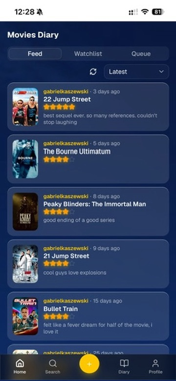
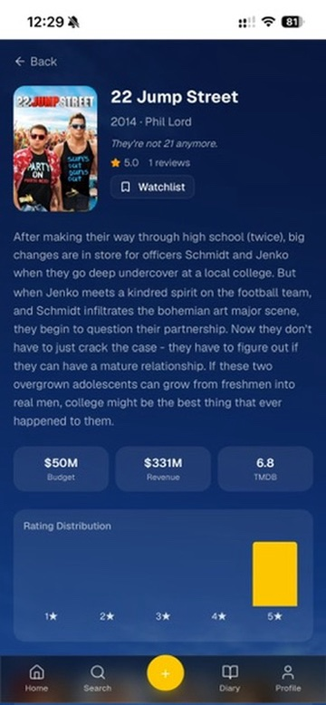
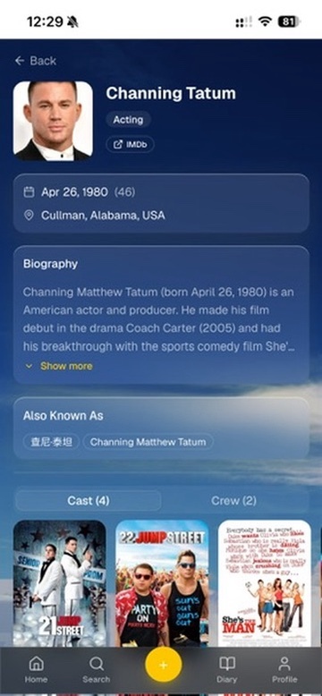
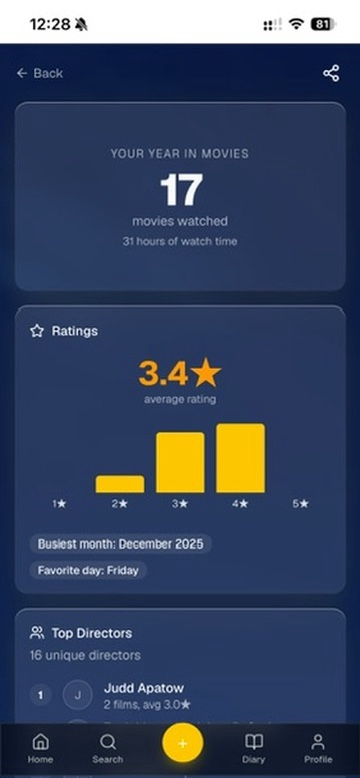

# Movies Diary

A self-hosted movie diary built in Rust. Ships a classic server-rendered HTML interface (no JavaScript) alongside a full React SPA, both backed by the same REST API. Federates over ActivityPub so reviews reach the Fediverse. Supports Jellyfin and Plex auto-import, full-text search, annual wrap-ups, goals, and bulk import from Letterboxd, IMDb, and other sources. Runs on SQLite.

[](LICENSE)
[](https://www.rust-lang.org/)
[](https://hub.docker.com/)
[](https://activitypub.rocks/)
[](https://www.sqlite.org/)

---

## Table of Contents

- [Quick Start](#quick-start)
- [Features](#features)
- [Screenshots](#screenshots)
- [Architecture](#architecture)
- [Prerequisites](#prerequisites)
- [Configuration](#configuration)
- [Run](#run)
- [API](#api)
- [SPA](#spa)
- [Development](#development)
- [Test](#test)
- [Docker](#docker)
- [Media Server Integration](#media-server-integration)
- [Annual Wrap-Up](#annual-wrap-up)
- [Contributing](#contributing)
- [License](#license)

---

## Quick Start

The fastest way to run Movies Diary is via Docker Compose:

```bash
cp .env.example .env
# Set JWT_SECRET and OMDB_API_KEY (or TMDB_API_KEY) in .env
docker compose up -d
```

Open `http://localhost:3000`. The HTTP server and background worker start together; data is persisted in a Docker volume.

---

## Features

- Log movies with a TMDB/OMDb ID or manual title/year/director, with a 1–5 rating and optional watch medium (cinema, streaming, TV, physical media, download, media server)
- Edit reviews after the fact — update rating, comment, date, or watch medium via partial PATCH; each watch is still a separate record (re-watches tracked)
- Spoiler Flag — authors mark a review as containing spoilers; the comment is veiled (blur + reveal) for every viewer except the author, withheld from RSS, and federates as `containsSpoilers` + an AP `summary` content warning so Mastodon-style clients also collapse it
- Background poster fetching and storage (local filesystem or S3-compatible)
- Movie enrichment via TMDb — full cast, crew, genres, keywords, runtime, budget/revenue, ratings; fetched automatically on movie discovery and refreshed every 30 days; exposed via `GET /api/v1/movies/{id}/profile`
- Full-text search across movies and people via `GET /api/v1/search` — free-text query plus structured filters (genre, year, person, department, language); backed by SQLite FTS5
- People as first-class entities — browse by person via `GET /api/v1/people/{id}` and full credit history via `GET /api/v1/people/{id}/credits`; index populated automatically during TMDb enrichment
- RSS/Atom feed for public subscription (global and per-user)
- JWT authentication via cookie (HTML) or Bearer token (REST API)
- ActivityPub federation — follow/unfollow remote users, accept/reject/remove followers, federated reviews broadcast as `Note` objects with movie poster image attachment, `#MoviesDiary` + `#MovieTitle` hashtags, paginated outbox (reviews, watchlist entries, goals), boost/Announce tracking, NodeInfo discovery endpoint, shared inbox delivery, actor profile sync (bio, avatar, discoverable); account migration via `Move` activity; account deletion broadcasts `Delete` actor to followers
- Federation moderation — instance-level domain blocking (admin-managed), per-user actor blocking with `Block` / `Undo Block` activities, delivery filter excludes blocked actors and blocked-domain inboxes
- Watchlist — add movies to watch later, per-user; federated watchlist entries visible for remote actors
- User profiles — display name, bio, avatar, banner, custom profile fields; editable via HTML settings page or REST API; account deletion broadcasts AP `Delete` actor activity; `alsoKnownAs` change triggers AP `Move` for account migration
- Jellyfin/Plex auto-import — media server sends a webhook on playback stop, movies land in a watch queue; review and confirm with a rating to create diary entries; per-user webhook tokens with SHA-256 auth; setup UI at `/settings/integrations`
- Annual Wrap-Up — Spotify Wrapped for movies: per-user and instance-wide year-in-review with stats (top directors, actors, genres, rating distribution, watch time, watch medium breakdown, rewatches, budget analysis); directors/actors filtered by minimum watch count for statistical relevance; shareable HTML page at `/wrapups/{user_id}/{year}`; admin-triggered or auto-generated in January
- Goals — set a "watch N movies in YEAR" target with a progress bar; progress computed from existing reviews (backwards compatible); per-user federation toggle in settings; displayed on profile (SPA: interactive with create/edit/delete, classic HTML: read-only glassmorphic card)
- Profile trends — top directors, genre breakdown, rating distribution histogram, watch medium breakdown, monthly activity chart; all computed from the user's review history
- Account deletion — self-service (own password) or admin (admin's password) from the settings page, profile page, or `DELETE /api/v1/users/me` / `DELETE /api/v1/users/{id}`; the account is tombstoned at once, then a background purge erases its data and tells the fediverse; usernames are never reused (ADR-0016)
- CSV and JSON diary export
- File importer: upload CSV, TSV, JSON, or XLSX from any source (Letterboxd, IMDb, etc.), map columns to domain fields via a step-by-step wizard or REST API, save mapping profiles for repeat imports
- REST API v1 (`/api/v1/`) with full feature parity with the HTML interface
- OpenAPI documentation at `/docs` (Swagger UI)
- CSRF protection on all HTML form routes (double-submit cookie, defense-in-depth on top of `SameSite=Strict`)
- Per-IP rate limiting via token bucket (production-grade, backed by `axum-governor`)
- Single-page app at `/app/` — React + TanStack Router + shadcn/ui, built with Vite, served from the backend with client-side routing fallback
- Terminal UI client (`crates/tui`, deprecated) for logging reviews, bulk CSV import, and diary browsing

## Screenshots

> SPA at `/app/` — React + TanStack Router + shadcn/ui

| Feed | Movie | Person |
|------|-------|--------|
|  |  |  |

| Profile | Wrap-Up | Wrap-Up card |
|---------|---------|--------------|
|  |  |  |

## Architecture

Hexagonal (Ports & Adapters) with Domain-Driven Design:

```
api-types           — shared REST API request/response DTOs (Serialize/Deserialize + utoipa schemas) + HtmlPageContext; used by http-axum and tui
config              — typed configuration (defaults, config.toml, legacy env names); loaded once by the binaries
bootstrap           — composition root: the only crate that names adapters; builds the server router and the worker service
event-payload       — serde payloads for domain events, shared by the NATS and SQLite-queue adapters
domain              — pure types and CQRS port traits (MovieCommand/MovieQuery, WatchEventCommand/WatchEventQuery, GoalCommand/GoalQuery, DiaryQuery, PersonCommand/PersonQuery, SearchCommand/SearchPort, SocialCommand/SocialQuery, ImageFetcher, RssFeedRenderer), no external deps except serde
application         — use cases (commands + queries), business logic orchestration; handlers delegate here for all domain logic; modules: auth, diary, goals, import, insights, integrations, jobs, movies, person, search, social, users, watchlist, wrapup
server              — thin HTTP binary (dotenv, config, bootstrap::build_server, axum::serve); features (federation, nats) forward to bootstrap
worker              — thin worker binary (bootstrap::build_worker, run until ctrl-c)
adapters/
  http-axum            — Axum HTTP adapter: JSON API, classic HTML UI (askama templates), OpenAPI spec, Swagger UI, federation-gated routes; library crate, no binary of its own
  auth                 — JWT issuance and validation (Argon2 passwords)
  sqlite               — SQLite repositories (one module per aggregate under repositories/), search (FTS5), social graph, durable event queue, connection factory + migrations; the only storage adapter
  metadata             — TMDB / OMDb HTTP client
  poster-fetcher       — downloads poster images
  object-storage       — stores images (posters + user avatars) on local filesystem or S3-compatible storage
  image-converter      — optional background worker: converts stored images to AVIF or WebP; backfills existing images via a 24h periodic job
  tmdb-enrichment      — TMDb HTTP client implementing MovieEnrichmentClient and PersonEnrichmentClient; event handlers (MovieEnrichmentHandler, PersonEnrichmentHandler) live in the application layer
  rss                  — RSS/Atom feed generation
  export               — CSV and JSON diary serialization
  importer             — CSV/TSV/JSON/XLSX parser and column mapper for bulk import
  media-server        — Jellyfin and Plex webhook payload parsers (MediaServerParser adapter; Plex requires Plex Pass)
  event-publisher      — in-memory event channel
  nats                 — NATS Core / JetStream event publisher and consumer
  activitypub          — ActivityPub federation adapter (follow, inbox/outbox, actor); delegates to k-ap for protocol internals
  sqlite-federation    — SQLite-backed federation repository (k-ap trait implementations; only built with the `federation` feature)
tui                 — terminal UI client (ratatui); shares api-types with http-axum for typed API access
spa/                — React SPA (TanStack Router + shadcn/ui + Vite); served at /app/ by the backend
```

## Prerequisites

- Rust (stable, 2024 edition)
- SQLite
- Poster storage: local filesystem (zero deps) or an S3-compatible object store (e.g. MinIO)
- An [OMDb API key](https://www.omdbapi.com/apikey.aspx)

## Configuration

Settings are layered, later sources winning:

1. built-in defaults
2. `config.toml` in the working directory, or the file named by `CONFIG_FILE` (a named file that does not exist is an error; the default `config.toml` is optional)
3. environment variables (including those from `.env`), under the names in the table below

Copy `.env.example` to `.env` and set the values you need. Malformed values (a non-numeric `PORT`, an unknown `EVENT_BUS_BACKEND`) fail startup with a message naming the setting. An empty value (`PORT=`) counts as unset, so the default applies. The variable names are unchanged from earlier releases; every one except `RUST_LOG` and `CONFIG_FILE` maps to a `section.field` key in `config.toml` (for example `PORT` is `server.port`, `JWT_SECRET` is `auth.jwt_secret`).

| Variable | Default | Required | Description |
|---|---|---|---|
| `DATABASE_URL` | — | Yes | SQLite connection string (e.g. `sqlite://movies.db`); the only value the config loader itself requires |
| `JWT_SECRET` | — | Server | Secret for JWT signing — use a long random string. The server refuses to start without it (the worker does not need it) |
| `OMDB_API_KEY` | — | One of the two | [OMDb](https://www.omdbapi.com/apikey.aspx) key for movie metadata. Server and worker refuse to start unless `TMDB_API_KEY` or `OMDB_API_KEY` is set |
| `TMDB_API_KEY` | — | One of the two | [TMDb](https://www.themoviedb.org/settings/api) key — used for metadata when set (takes precedence over OMDb); enables cast, crew, genres, enrichment |
| `BASE_URL` | `http://localhost:3000` | No | Public URL of your instance (used for ActivityPub actor URLs); set it for any real deployment |
| `IMAGE_STORAGE_BACKEND` | `local` | No | `local` or `s3` |
| `IMAGE_STORAGE_PATH` | `./images` | No | Path for local image storage |
| `MINIO_ENDPOINT` | — | S3 only | S3-compatible endpoint (e.g. `http://localhost:9000`) |
| `MINIO_BUCKET` | — | S3 only | Bucket name |
| `MINIO_REGION` | `minio` | No | Region for S3 storage |
| `MINIO_ACCESS_KEY_ID` | — | S3 only | Access key ID |
| `MINIO_SECRET_ACCESS_KEY` | — | S3 only | Secret access key |
| `IMAGE_CONVERSION_ENABLED` | `false` | No | Set `true` to convert stored images to AVIF or WebP (only the value `true` enables it) |
| `IMAGE_CONVERSION_FORMAT` | — | When conversion is enabled | `avif` or `webp`; the worker fails at startup if conversion is enabled without it |
| `HOST` | `0.0.0.0` | No | Bind address |
| `PORT` | `3000` | No | HTTP port |
| `RATE_LIMIT` | `60` | No | Requests per minute per IP |
| `ALLOW_REGISTRATION` | `false` | No | Set `true` (or `1`) to allow new sign-ups |
| `SECURE_COOKIES` | `false` | No | Set `true` when serving over HTTPS (only the value `true` enables it) |
| `RUST_LOG` | — | No | Log verbosity (e.g. `server=info,worker=info,bootstrap=info,config=info,http_axum=info`); read by the logger, not part of `config.toml` |
| `CORS_ORIGINS` | empty | No | Comma-separated allowed origins for the API; empty or `*` allows any origin |
| `EVENT_BUS_BACKEND` | `db` | No | `db` (default) or `nats` |
| `NATS_URL` | — | NATS only | NATS connection URL (e.g. `nats://localhost:4222`) |

`DATABASE_URL` is the only setting the loader requires; the other "required" entries are enforced when the corresponding adapter is built, and failing there also stops startup. Further optional variables (`CONFIG_FILE`, `JWT_TTL_SECONDS`, `REFRESH_TTL_SECONDS`, `POSTER_FETCH_TIMEOUT_SECONDS`, `EVENT_CHANNEL_BUFFER`, `EVENT_QUEUE_*`, `NATS_MODE`, `NATS_STREAM_NAME`, `NATS_SUBJECT_PREFIX`, `NATS_CONSUMER_NAME`, `FEDERATION_DEBUG`, `WRAPUP_*`) are read by `crates/config`; see `crates/config/src/` for defaults.

### Cargo features

| Feature | Default | Effect |
|---|---|---|
| `federation` | yes | ActivityPub federation (`activitypub`, `sqlite-federation`, federation routes) |
| `nats` | no | NATS event bus (`EVENT_BUS_BACKEND=nats`) |

Build without federation with `--no-default-features`. `sqlite` and `sqlite-federation` are deprecated aliases kept so old build commands still work.

### Build notes

- `cargo build` / `cargo test` build every crate except the deprecated `tui`, which sits outside `default-members`. Use `-p tui` for it; `make check` and CI use `--workspace`, so it is still linted and tested.
- Release builds use `codegen-units = 1` and `strip = true` (smaller binaries; thin LTO was measured and made builds slower and binaries larger, so it is off).
- SQLite is compiled from source (bundled `libsqlite3-sys`), so the first clean build spends about a minute on it; incremental builds and the Docker/CI caches don't repeat that.
- TLS uses rustls with the `ring` provider only; `aws-lc` and `actix` are kept out of the graph by `make check-no-second-web-stack`.

The `worker` binary must run alongside `server` to process events:

```bash
cargo run -p worker
```

## Run

```bash
cargo run -p server         # HTTP server (0.0.0.0:3000)
cargo run -p worker         # event worker (poster sync, in a separate terminal)
```

The worker polls the event queue and must run alongside the server to process background tasks like poster fetching. Both processes share the same database.

**Event flow.** The server never publishes events directly: every write that raises an event stores it in the `event_queue` table in the same transaction (a transactional outbox, see [ADR-0015](docs/adr/0015-transactional-outbox.md)). With `EVENT_BUS_BACKEND=db` the worker consumes those rows; with `nats` the worker relays them to JetStream (with `Nats-Msg-Id` set to the event id) and consumes them from there. Duplicates are filtered in three layers: the broker's duplicate window, a claim lease on queue rows, and a per-(event, handler) processed-event ledger. Handlers must stay idempotent.

## API

All REST endpoints are under `/api/v1/`. Authentication uses `Authorization: Bearer <token>` obtained from `POST /api/v1/auth/login`.

Interactive API documentation is available at runtime:

- **Swagger UI** — `http://localhost:3000/docs`

An [Insomnia](https://insomnia.rest/) collection covering all endpoints is included at [`movies-diary.insomnia.json`](movies-diary.insomnia.json). Import it via **File → Import**, set `base_url` and `token` in the environment, and you're ready to go.

## SPA

The single-page app lives in `spa/` and is served at `/app/` by the backend. For local development:

```bash
cd spa && bun install && bun run dev   # http://localhost:5173/app/
```

Set `CORS_ORIGINS=http://localhost:5173` in the backend `.env` to allow cross-origin API calls during development.

For production, `bun run build` outputs to `spa/dist/` which the backend serves statically (included in Docker image automatically).

## Terminal UI (deprecated)

> **Note:** The TUI was an experiment with ratatui and is no longer actively maintained. It may not support newer features (goals, watchlist, federation, etc.). Contributions welcome — if you'd like to maintain it, open a PR.

```bash
cargo run -p tui
```

Supports review logging, bulk CSV import, and diary browsing.

## Development

A `Makefile` wraps the most common dev commands:

```bash
make           # make check: the full gate, same steps as CI
make fix       # auto-apply fmt + clippy fixes
make fmt       # apply rustfmt
make clippy    # clippy with -D warnings
make test      # cargo test --workspace
```

`make check` runs fmt-check, clippy, tests (default features and `--no-default-features`), and the layering guards (see `CONTRIBUTING.md`).

## Test

```bash
cargo test --workspace        # everything; needs no external services
cargo test -p application     # business logic tests only — in-memory fakes, no database
cargo test -p domain          # domain model + value object tests
cargo test -p bootstrap       # route smoke, API and handler tests over the real wiring
cargo llvm-cov -p application -p domain   # line coverage report (requires cargo-llvm-cov)
```

Tests live in `crates/<crate>/tests/`; the exceptions are listed in `CODE_STYLE.md`. The `application` and `domain` crates have 400+ tests covering all use case modules (auth, diary, goals, import, insights, integrations, movies, person, search, users, watchlist, wrapup) backed by the in-memory fakes and factories in `domain::testing` (the `test-helpers` feature). They are the fastest feedback loop for business logic changes.

## Docker

### Quick start

```bash
cp .env.example .env
# Edit .env — set JWT_SECRET and OMDB_API_KEY (or TMDB_API_KEY)
docker compose up -d
```

This builds and starts the HTTP server (port 3000) and event worker. Data is persisted in a Docker volume.

### Manual docker run

The image contains both `server` and `worker` binaries. Run them as separate containers sharing the same data volume:

```bash
docker build -t movies-diary .

docker run -p 3000:3000 --env-file .env -v movies-diary-data:/data movies-diary
docker run --env-file .env -v movies-diary-data:/data --entrypoint ./worker movies-diary
```

Default build enables `federation`; add NATS with `--build-arg FEATURES=federation,nats`. The Dockerfile uses [cargo-chef](https://github.com/LukeMathWalker/cargo-chef): dependencies are compiled in their own layer keyed on the manifests, so a source-only change rebuilds just the workspace crates. BuildKit cache mounts keep the cargo registry between builds. No Dockerfile edit is needed when a crate is added. SQLite is the only database backend (see [ADR-0012](docs/adr/0012-sqlite-is-the-only-backend.md)).

## Media Server Integration

Auto-log movies you finish watching. Go to `/settings/integrations` to generate a webhook token, then configure your media server.

### Jellyfin

1. Install the **Webhook** plugin (Dashboard > Plugins > Catalog)
2. Add a **Generic** destination:
   - **URL**: `https://yourdomain.example.com/api/v1/webhooks/jellyfin`
   - **Header**: `Authorization` = `Bearer <your-token>`
   - **Send All Properties**: enabled
   - **Notification Type**: Playback Stop only
   - **Item Type**: Movies only

### Plex (requires Plex Pass)

1. Go to Settings > Webhooks in your Plex server
2. Add webhook URL: `https://yourdomain.example.com/api/v1/webhooks/plex`
3. Plex does not support custom headers natively — pass the token as a query param: `https://yourdomain.example.com/api/v1/webhooks/plex?token=<your-token>`

Movies you finish watching appear in your watch queue at `/watch-queue` — rate and confirm to add to your diary.

## Annual Wrap-Up

Generate a year-in-review summary for any user — top directors, actors, genres, rating distribution, total watch time, rewatch stats, and more. Available as a shareable HTML page.

**Generate via API** (admin only):
```bash
curl -X POST http://localhost:3000/api/v1/wrapups/generate \
  -H "Authorization: Bearer <admin-token>" \
  -H "Content-Type: application/json" \
  -d '{"user_id": "<uuid>", "start_date": "2025-01-01", "end_date": "2026-01-01"}'
```

Omit `user_id` for a global instance wrap-up. The worker computes stats in the background — poll `GET /api/v1/wrapups/{id}` for status.

**View:** `http://localhost:3000/wrapups/{user_id}/2025` (public, no login required)

**Auto-generate:** The worker runs a daily job in January that generates wrap-ups for all users with reviews in the previous year.

## Contributing

See [CONTRIBUTING.md](CONTRIBUTING.md) for setup instructions, architecture overview, and PR guidelines.

## License

MIT License. See [LICENSE](LICENSE).
